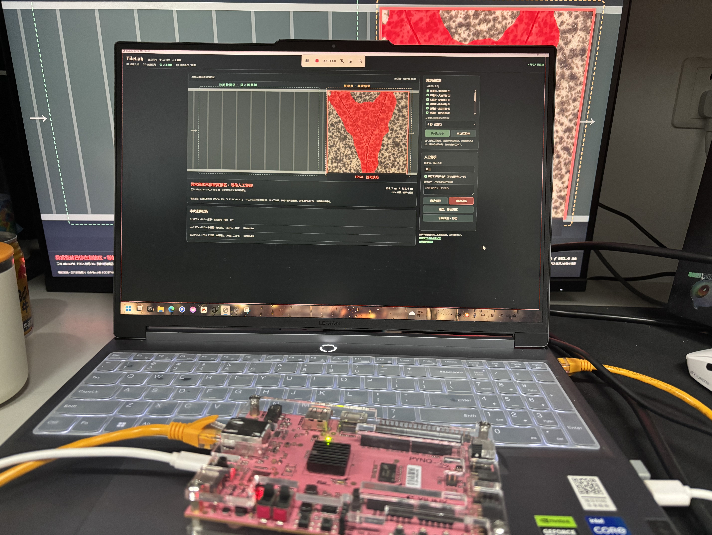

# TileLab FPGA瓷砖缺陷筛查与匀速模拟流水线

电脑模拟真实照片输送，进入检测区即截图经网口交给PYNQ-Z2的PL硬件。有效未报警结果匀速自动通过，报警或结果迟到在右侧复核区停下。人工确认方式本次会话保留一次，自动通过与人工意见分别留档。

**当前软件与报告V208，FPGA计算核心沿用冻结V202，100MHz。** 没有更换BIT、ELF、模型或阈值。仓库已经公开，原创代码MIT；数据、派生参照和厂商代码分别保留原许可。

## 当前入口

- [技术报告Word](project/pynq_z2_tile_v1_53/reports/v208/TileLab_比赛技术报告_V208.docx) · [PDF](project/pynq_z2_tile_v1_53/reports/v208/TileLab_比赛技术报告_V208.pdf)
- [组包与复现](docs/reproduction.md) · [接线](docs/hardware_setup.md) · [流水线源码](project/pynq_z2_tile_v1_53/host/conveyor_station)
- [计算分工](docs/architecture.md) · [协议和故障处理](docs/interface.md) · [模型](docs/MODEL.md)
- [原始证据与计时范围](metrics/README.md) · [匀速实板回放](project/pynq_z2_tile_v1_53/reports/v208/conveyor_acceptance.json)
- [失败与局限](docs/limitations.md) · [当前版本说明](CURRENT_MATERIALS.json)

## 实际分工

|部分|职责|
|---|---|
|电脑CPU/浏览器|模拟运动、native canvas截图、PNG解码与RGB打包、网络、叠加显示、自动策略、人工复核及记录|
|ARM PS|网络、CRC、DDR地址和任务控制|
|FPGA PL|缩放、定点归一化、INT8 MobileNetV2特征、投影、参照距离、报警与粗异常区域|

PC/GPU/ARM不执行运行时视觉推理；浏览器渲染可能使用GPU。红色区域位置由PL计算，红色叠加由电脑绘制。电脑HDMI可直接接外屏，BIT内保留的HDMI视频模块未参与当前取帧检测。没有实体相机、输送电机或机械剔除装置。

## 证据边界

|指标|结果|范围|
|---|---|---|
|V202公开开发图|117张，33正常未报警、84缺陷报警，分数与掩膜逐值一致|反复参与开发，不是独立准确率|
|PL内核均时|124.72ms|历史117图|
|传图检测均时|501.79ms|历史117图，不含完整应用流程|
|截图至应用收到结果|约2.48～2.56s|新增少量匀速实板联调，范围更宽|
|检测区行进预留|4秒|模拟配置，不是内核耗时|
|匀速流程|2正常不停，2裂纹在复核区停下，勾选保留|显式程序回放，自动通过2次，非人工复核1次|
|离线保护测试|18项通过|流程、策略和通信保护，不代替上板|

约8.02fps为重复DDR固定帧内核微基准，不能当新视频吞吐。历史310秒有限验证和一次本机HTTP超时及恢复均保留，不能宣称全天长稳。尚无同口径CPU/GPU加速比、功耗或独立现场质量验证。

## 复现与材料

随附本地V208完整工程ZIP/RAR，含匹配硬件和最新软件。公开仓库另提供[按版本源文件重建同一目录](tools/build_v208_bundle.py)的工具；克隆当前分支后运行 `python tools/build_v208_bundle.py --out ../TileLab_V208`，再按复现文档离线校验和部署。无需依赖开发者D盘目录。

已收到参赛者整机实拍、板卡近照和现场工作站截图，并补入报告。原始视频已在本机定位，尚未剪辑，不能称最终成片已验收。自动回放截图保留非人工标记，参赛者提供的实拍和现场截图另行注明。比赛上传与签署是后续单独步骤，本更新不表示已提交。

原创内容[MIT](LICENSE)；MVTec照片/派生参照CC BY-NC-SA4.0，陶瓦照片CC BY4.0，厂商内容沿用原条款，见[许可范围](LICENSE_SCOPE.md)。[旧版首页](README_HISTORY_V203.md)仅作历史记录。
