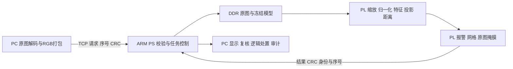

# 系统架构与设计选择

本文描述冻结V202停驻检测，不以历史HDMI候选代表当前工位吞吐。

PC不计算模型特征、异常分数或阈值判定。PS运行裸机网络与控制固件，负责CRC，不执行视觉推理。PL独立承担从原图尺度变换到异常输出的计算。离线Python/Torch工具用于开发、拟合和核对，不属于运行时后备。

## 为什么这样划分

MobileNetV2的深度/逐点卷积便于用有限计算资源复用；正常参照提供固定花色下的异常比较依据。图像内部统一224×224，采用47步任务图与DDR工作区，保留28×28粗网格，控制存储与计算需求。选择理由是本工程预算下的实现取舍，不是与所有模型比较后的最优结论。

卷积权重和特征采用INT8，卷积累加为INT32，投影、距离及后处理使用所需的更宽整数。行缓存、局部累加和128位打包减少重复访问；计算单元分时复用，避免逐层完全展开造成资源不足。代价是阶段调度与DDR等待。

PC处理解码、显示和交互便于迭代，PS处理网络和控制；本任务没有AI PC端模型，因此不增设PC推理。PL包含真实计算核，普通转接板无法提供这条计算数据通路。纯软件可实现同类算法；本项目没有同口径性能、功耗对照，不能声称只有FPGA能检测或已证明软件不可替代。

## 候选取舍

| 候选 | 已有证据 | 交付决定 |
|---|---|---|
| 100MHz整数MobileNetV2参照链路 | 117图逐值复现、有限闭环复测 | 保留V202 |
| HFENet硬件候选 | 单张约94.6秒，模型和输入条件不同 | 不纳入默认交付，不直接比较准确率 |
| 125MHz候选 | 历史时序/连续验收未稳定通过 | 不用固定帧峰值替代系统验收 |
| 50MHz候选 | 后续117图未完成且出现POR | 未晋升 |
| 跨材质直接沿用原参照 | 陶瓦20张正常全部误报 | 按材质另建参照并独立验证 |

主贡献是完整PL映射、整数与存储实现、接口和可追溯流程；MobileNetV2、近邻异常思想和厂商IP属于已有基础。物理相机、输送和分选执行器尚未接入。[失败证据](limitations.md)与[指标](../metrics/README.md)分别给出事实范围。
